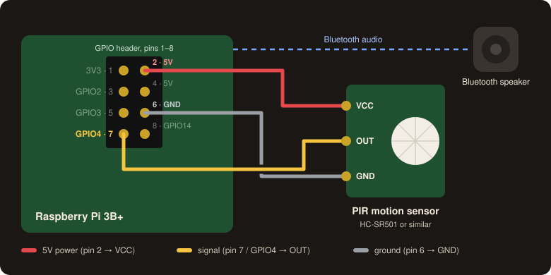
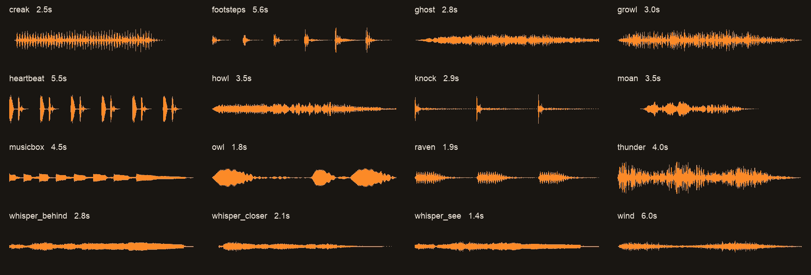

# MotionScare

A Raspberry Pi Halloween scare for the front door. A motion sensor spots trick-or-treaters walking up,
and a hidden Bluetooth speaker plays a spooky sound: footsteps creeping closer, a slow heartbeat,
a whisper of "I'm right behind you…".

<p align="center">
  
</p>

<p align="center">
  
</p>

<sub>The waveforms are rendered from the sounds <code>make_sounds.sh</code> generates (<code>tools/render_waveforms.sh</code>).</sub>

## Why I built this

Store-bought motion props play the same canned scream every time. That's boring by the third
group of kids, and a scream is the wrong sound for the littlest trick-or-treaters.

So I wanted something that:

- **Is scary without making little kids cry.** Every sound swells in. Nothing starts at full volume,
  so there's no sudden jump scare (you can see that in the waveforms above).
- **Gets a bit scarier as the night goes on.** Little kids come early and big kids come later, so it
  plays quieter until 7:30pm, then switches to full volume and any extra jump scares you've added.
- **Doesn't repeat itself.** It never plays the same sound twice in a row, and it often layers two
  sounds, such as a heartbeat under a whisper.
- **Uses cheap parts:** a Raspberry Pi, a PIR motion sensor, and any Bluetooth speaker, which can be
  hidden anywhere near the door.
- **Can be changed on the night without a laptop.** Switch modes with one file, drop in new sounds
  without restarting, and talk through the speaker in a demon voice with `say.sh`.

## What it does

1. The PIR sensor on GPIO4 detects motion.
2. `scare.py` picks one or two sounds and avoids whatever played last. In scary mode, if you've added
   anything to `sounds/scary/`, it always ends on one of those.
3. It plays them through PipeWire on the Bluetooth speaker. A second sound starts 0.5–2s after the
   first, and the two overlap.
4. It waits for a cooldown (8s by default) so one group at the door doesn't set it off over and over.

### The sounds

`make_sounds.sh` generates them all with `sox`, with no downloads or licensing worries. The whispers
use `espeak-ng`.

| Sound | What it is |
|---|---|
| `heartbeat` | slow lub-dub, six beats |
| `footsteps` | six steps, each louder than the last |
| `knock` | three slow knocks on the door |
| `howl` | distant wolf howl |
| `wind` | a howling gust |
| `raven` | caw… caw… caw |
| `musicbox` | minor-key lullaby that slows down like it's winding down |
| `growl` | low beast growl that swells and fades |
| `whisper_see`, `whisper_closer`, `whisper_behind` | "I see you…", "come closer…", "I'm right behind you…" |
| `thunder`, `moan`, `creak`, `ghost`, `owl` | the originals |

### Modes

| Mode | Plays | Volume |
|---|---|---|
| `gentle` | `sounds/gentle/` | 0.6 |
| `scary` | `sounds/gentle/` + `sounds/scary/` | 1.0 |
| `auto` (default) | `gentle` until 7:30pm, then `scary` | — |

`sounds/scary/` is empty out of the box. Put your own jump scares there and they only play in scary
mode. To switch modes on the night without restarting anything:

```bash
echo gentle > ~/scare/mode   # or: echo scary > ~/scare/mode
rm ~/scare/mode              # back to auto
```

### Keeping the Bluetooth speaker awake

Bluetooth speakers go to standby after a few minutes with nothing playing, and waking one up
takes seconds. That's too late when someone is already at the door. PipeWire also suspends an idle
output after about 5 seconds, and waking it adds another 1–2 seconds of lag to every scare.

To prevent both, `scare.py` streams a 25 Hz hum nonstop at low volume. That's too low for a small
speaker to reproduce, so you don't hear it, but the speaker sees a signal and stays on. A background
thread also reconnects the speaker if it drops. If reconnecting keeps failing, it restarts the Pi's
Bluetooth service, because the Pi 3B+ Bluetooth chip occasionally gets stuck.

## Hardware

- Raspberry Pi running PipeWire (the default on Raspberry Pi OS Bookworm desktop). Built on a Pi 3B+.
- PIR motion sensor, HC-SR501 or similar, wired as shown above: **VCC → pin 2 (5V), OUT → pin 7
  (GPIO4), GND → pin 6**.
- Any Bluetooth speaker. A wired speaker on the headphone jack also works; leave
  `SCARE_BT_SPEAKER` unset.

On an HC-SR501, turn the **time-delay** knob fully anticlockwise (about 3s) and set the jumper to
**repeat trigger**. `scare.py` already has its own cooldown, and a long delay on the sensor just
makes it miss the next group.

## Setup on the Pi

```bash
sudo apt install sox espeak-ng python3-gpiozero ffmpeg   # ffmpeg only needed for .m4a sounds
git clone https://github.com/k-sangili/MotionScare ~/scare
cd ~/scare && ./make_sounds.sh
```

Pair the speaker once:

```bash
bluetoothctl
  scan on          # wait for your speaker's MAC to appear
  pair  AA:BB:CC:DD:EE:FF
  trust AA:BB:CC:DD:EE:FF
  connect AA:BB:CC:DD:EE:FF
```

Put your speaker's MAC in `scare.service` (`SCARE_BT_SPEAKER`), then install it as a user service
that starts at boot:

```bash
mkdir -p ~/.config/systemd/user
cp scare.service ~/.config/systemd/user/
systemctl --user daemon-reload
systemctl --user enable --now scare
sudo loginctl enable-linger $USER   # start at boot without anyone logging in
journalctl --user -u scare -f       # watch it
```

A working log should look something like this:

```
18:02:11 Mode now: gentle (16 sounds). Auto turns scary at 19:30
18:02:11 Keeping Bluetooth speaker 30:22:21:04:EC:80 connected and awake
18:02:12 Waiting for PIR on GPIO4 to settle...
18:02:14 Armed. Cooldown 8s.
18:04:37 BOO! [gentle] playing heartbeat.wav + whisper_closer.wav
```

## Usage

```bash
python3 scare.py                     # run forever (what the service does)
python3 scare.py --test              # play one scare and exit
python3 scare.py --all --mode scary  # play every sound once, in order, to check them
python3 scare.py --simulate          # no sensor needed: press Enter to fake motion
./say.sh "Who goes there..."         # say something in a demon voice on the speaker
```

Stop the service (`systemctl --user stop scare`) before `--all` if you don't want a real trigger
playing over it.

**Adding your own sounds:** drop `.wav`, `.mp3`, `.ogg`, `.flac` or `.m4a` files into
`sounds/gentle/` or `sounds/scary/`. The folder is re-read on every trigger, so there's no need to
restart.

## Configuration

Set these as `Environment=` lines in `scare.service`:

| Variable | Default | |
|---|---|---|
| `SCARE_BT_SPEAKER` | *(none)* | Bluetooth speaker MAC. Unset = default audio output. |
| `SCARE_HUM_VOLUME` | `0.15` | Volume of the keep-awake hum. Raise it if the speaker still sleeps, lower it if you can hear it. |
| `SCARE_SCARY_AFTER` | `19:30` | When `auto` mode turns scary. |
| `SCARE_GENTLE_VOLUME` | `0.6` | Volume in gentle mode. |
| `SCARE_COOLDOWN` | `8` | Seconds between scares. |
| `SCARE_COMBO_CHANCE` | `0.6` | Chance a scare layers two sounds. |
| `SCARE_PIN` | `4` | PIR GPIO (BCM numbering). |
| `SCARE_KEEPALIVE` | `240` | Seconds between Bluetooth connection checks. |
| `SCARE_SOUNDS` | `./sounds` | Sound folder. |

## Project layout

```
scare.py                  motion loop, sound picking, Bluetooth keep-awake and reconnect
make_sounds.sh            generates sounds/gentle/*.wav and hum.wav with sox + espeak-ng
say.sh                    speak text in a demon voice on the speaker
scare.service             systemd user service
tools/render_waveforms.sh renders docs/sounds.png (needs ffmpeg)
docs/                     README images
```

## Troubleshooting

- **Lag between motion and sound.** Check the log for `hum.wav missing`. Run `make_sounds.sh`, which
  creates it. Then check the HC-SR501 knobs (see Hardware).
- **Speaker goes to sleep anyway.** Raise `SCARE_HUM_VOLUME` (try 0.25). Some speakers need a stronger
  signal before they count it as playing.
- **You can hear a hum.** Lower `SCARE_HUM_VOLUME`. Bigger speakers with real bass can reproduce 25 Hz.
- **No sound but the log says BOO.** Run `bluetoothctl info <MAC>` and look for `Connected: yes`.
  Run `wpctl status` to see whether the `bluez_output` sink exists.
